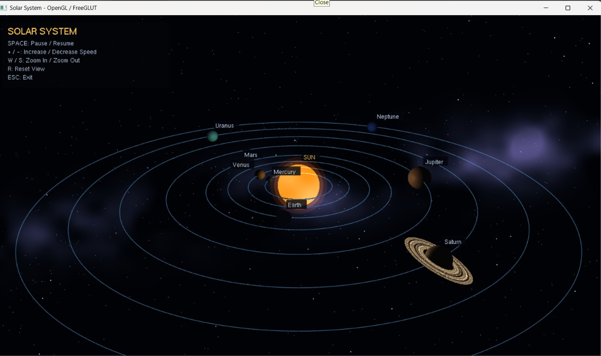

# 3D Solar System Simulation

A simple 3D Solar System simulation built with **C++, OpenGL, GLU, and FreeGLUT**. The program displays the Sun and all eight planets, draws their orbital paths, and animates their movement around the Sun.

## Project Output

The screenshot below is the output captured from this project:



## Features

- Displays the Sun and all eight planets: Mercury, Venus, Earth, Mars, Jupiter, Saturn, Uranus, and Neptune.
- Animates each planet along a circular orbital path.
- Shows the orbital paths, a star-point background, planet names, and Saturn's rings.
- Uses lighting, material colors, and an emission effect to make the Sun appear bright.
- Provides keyboard controls to pause the animation, change its speed, and zoom the camera.
- Displays the controls inside the application window.

## Computer Graphics Concepts Used

| CG Concept | One-line definition | Where it is used in this project |
|---|---|---|
| **3D Modeling / Geometric Primitives** | Creating 3D objects using basic geometric shapes. | `glutSolidSphere()` creates the Sun and the eight planets. |
| **2D and 3D Coordinates** | Representing positions using coordinate values on a plane or in 3D space. | The scene uses X, Y, and Z coordinates to position the planets, stars, and camera. |
| **Geometric Transformation – Translation** | Moving an object from one position to another without changing its shape. | `glTranslatef(x, 0.0f, z)` places each planet at its current orbital position. |
| **Circular Motion and Trigonometry** | Calculating points on a circle using sine and cosine. | `x = distance * cos(angle)` and `z = distance * sin(angle)` calculate each planet's position around the Sun. |
| **Viewing Transformation** | Setting the camera position, viewing direction, and up direction. | `gluLookAt()` positions the camera and controls the view of the 3D scene. |
| **Perspective Projection** | Showing distant objects smaller than nearby objects to create a 3D depth effect. | `gluPerspective()` sets the perspective view for the Solar System. |
| **Orthographic Projection** | Displaying objects without perspective size reduction, useful for flat 2D overlays. | `gluOrtho2D()` displays the title and keyboard instructions on the screen. |
| **Depth Buffering** | Using depth values to make nearer objects appear in front of farther objects. | `glEnable(GL_DEPTH_TEST)` enables depth testing for the 3D scene. |
| **Lighting and Shading** | Simulating light on object surfaces to give them a more realistic 3D appearance. | `GL_LIGHT0`, ambient/diffuse light, and `glShadeModel(GL_SMOOTH)` light and shade the spheres. |
| **Material and Emission** | Defining how an object's surface reacts to light and whether it emits light. | `glMaterialfv()` sets planet material colors, while `GL_EMISSION` gives the Sun a glow-like appearance. |
| **Point and Line Primitives** | Drawing graphics using individual points and connected line segments. | `GL_POINTS` draws the stars; `GL_LINE_LOOP` draws planetary orbits and Saturn's rings. |
| **Matrix Stack** | Saving and restoring transformation matrices so one object's changes do not affect another. | `glPushMatrix()` and `glPopMatrix()` isolate transformations while drawing objects. |
| **Animation** | Creating movement by updating object values repeatedly over time. | `update()` changes the orbital angles and `glutTimerFunc(16, ...)` schedules the next update. |
| **Double Buffering** | Drawing a frame in a hidden buffer and then displaying it to reduce flicker. | `GLUT_DOUBLE` and `glutSwapBuffers()` display completed frames. |
| **Text Rendering** | Displaying readable text at selected positions in a graphics window. | `glutBitmapCharacter()` draws the Sun name, planet names, and on-screen instructions. |

## How the Simulation Works

1. **Create the window:** `main()` initializes FreeGLUT, creates the graphics window, and registers the display, keyboard, reshape, and timer callbacks.
2. **Set up the scene:** `init()` enables depth testing and lighting, sets the background color, and configures the light source.
3. **Set the camera and projection:** `reshape()` configures the viewport and perspective projection; `display()` applies the camera view using `gluLookAt()`.
4. **Draw the objects:** `display()` draws the star background, Sun, orbital paths, planets, Saturn's rings, and the on-screen instructions.
5. **Animate the planets:** `update()` increases each planet's angle according to its individual `orbitSpeed` and the global animation `speed` value.
6. **Handle user input:** `keyboard()` responds to the controls listed below.

### How a Planet's Orbital Position Is Calculated

Each planet has an orbital distance and a changing angle. The program converts the angle from degrees to radians and calculates its X and Z coordinates:

```cpp
float a = angle[i] * PI / 180.0f;
float x = planets[i].distance * cos(a);
float z = planets[i].distance * sin(a);
```

The angle is updated while the animation is running:

```cpp
angle[i] += planets[i].orbitSpeed * speed;
```

This makes the planet move around the Sun on a circular path in the X-Z plane. The planets have different orbital speeds, so they do not all move at the same rate.

## Project Structure

```text
3D-Solar-System/
├── solar_system.cpp              # Main C++ and OpenGL source code
├── README.md                     # Project explanation and instructions
└── assets/
    └── solar-system-output.png   # Screenshot of the running project
```

## Requirements

- Windows with a C++ compiler (MinGW-w64 / g++ or Visual Studio).
- OpenGL and GLU development libraries.
- FreeGLUT development files (headers and library).
- A terminal or IDE configured to find the required headers and libraries.

## Compile and Run (MinGW on Windows)

Open a terminal in the project folder, where `solar_system.cpp` is located.

**1. Compile the program:**

```bash
g++ solar_system.cpp -o solar.exe -lfreeglut -lopengl32 -lglu32
```

**2. Run the executable:**

In Command Prompt:

```bat
solar.exe
```

In PowerShell:

```powershell
.\solar.exe
```

Make sure FreeGLUT is installed and its include and library paths are configured for your MinGW compiler. The compile command above assumes the FreeGLUT library can be found by the linker.

## Keyboard Controls

| Key | Action |
|---|---|
| `SPACE` | Pause or resume the planetary animation. |
| `+` or `=` | Increase animation speed. |
| `-` | Decrease animation speed (minimum speed is `0.1`). |
| `W` | Zoom in. |
| `S` | Zoom out. |
| `R` | Reset zoom and animation speed to their default values. |
| `ESC` | Exit the application. |

## Important Notes / Simplifications

- Planet sizes, orbital distances, and orbital speeds are illustrative; they are **not to astronomical scale**.
- The program animates the planets' revolution around the Sun; it does not implement each planet's rotation around its own axis.
- The orbital paths are circular and lie in the X-Z plane.
- The project uses the traditional fixed-function OpenGL / FreeGLUT API for learning and demonstration.

## Source File

The complete implementation is in [`solar_system.cpp`](solar_system.cpp). 


## Member Teams
Mohammad Mustafa B-28  
Pawan Kumar B-45

